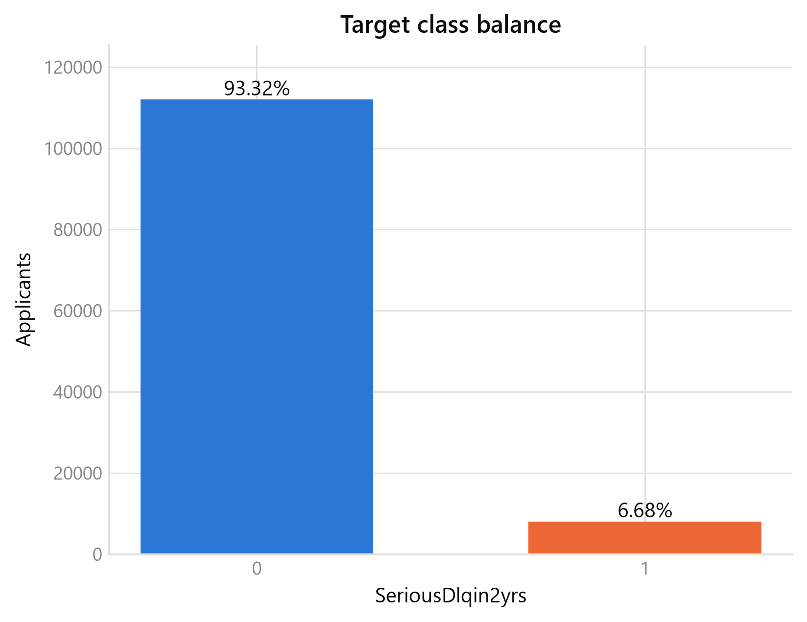
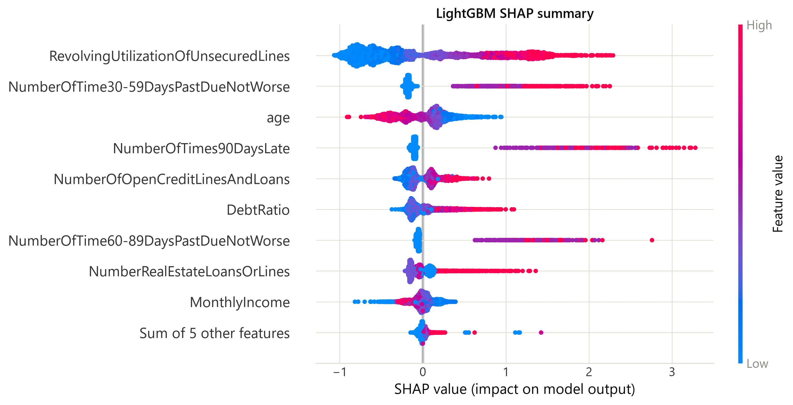

# Credit Risk Scoring

Probability-of-default modelling on the *Give Me Some Credit* dataset, from
exploratory analysis through hyperparameter search to a served scoring API with
per-applicant decline reasons, using SHAP values.

Four models are compared. Logistic Regression, Random Forest, XGBoost, LightGBM


---

## Results

Test set, 30,000 applications:

| Model | PR-AUC | ROC-AUC | Gini | KS | Brier |
|---|---|---|---|---|---|
| **LightGBM** | **0.4082** | **0.8693** | **0.7386** | **0.5833** | 0.0780 |
| XGBoost | 0.4078 | 0.8688 | 0.7377 | 0.5807 | 0.0687 |
| Random Forest | 0.4046 | 0.8669 | 0.7338 | 0.5792 | 0.0489 |
| Logistic Regression | 0.3832 | 0.8602 | 0.7203 | 0.5621 | 0.1466 |

PR-AUC leads because only 6.68% of applications default.

<p align="center">
  
  
</p>

---

## How the model was chosen

The 150,000 applications are split 80/20, stratified on the target.

```
150,000 applications
   |
   +-- 120,000 TRAINING -------------------------+     30,000 TEST
   |                                             |     
   |  [1] which hyperparameters                  |
   |      Optuna, 30 trials x 4 models x 5 folds |
   |      = 600 fits, all discarded              |
   |                                             |
   |  [2] which model                            |
   |      4 tuned configurations, same folds     |
   |      = 20 fits, all discarded               |
   |      -> LightGBM                            |
   |                                             |
   |  [3] one fit on all 120,000 -> the model    |
   +---------------------------------------------+
                                                 |
                                   
```

Cross-validation:

| | mean PR-AUC | standard error |
|---|---|---|
| LightGBM | 0.4034 | 0.0023 |
| XGBoost | 0.4017 | 0.0024 |
| Random Forest | 0.3988 | 0.0014 |
| Logistic Regression | 0.3715 | 0.0034 |

---

## Calibration

The cut-off below needs probabilities that are right in level, so isotonic calibration is fitted inside a 5-fold wrapper: each fold
learns its map on the part of the data its model never saw.

| | PR-AUC | KS | Brier | ECE |
|---|---|---|---|---|
| Uncalibrated | 0.4082 | 0.5833 | 0.0780 | 0.1294 |
| Isotonic | 0.4078 | 0.5818 | 0.0486 | 0.0026 |


<p align="center">
  
</p>

The calibrated model decides;
`credit_model_uncalibrated.pkl` exists because TreeSHAP needs one booster while the
calibrated model is an ensemble of five. Being monotone, the map between them
preserves the ordering the explanations are about.

---

## Values that are not measurements

The delinquency counters stop at 17 and then have go to 96 and 98; revolving
utilisation reaches 50,708; `DebtRatio` holds a raw amount rather than a ratio
wherever income is missing. These are values that measure nothing, so they are handled separately from outliers:


---

## The decision cut-off

Rejecting a sound applicant forgoes the margin `r`; approving one who defaults
loses `LGD` of the exposure. For an applicant with predicted probability `p`:

```
approve:  p * LGD * EAD          reject:  (1 - p) * r * EAD
```

Rejecting is cheaper once `p > 1 / (k + 1)`, where `k = LGD / r`. The exposure
cancels, so the cut-off does not depend on loan size. With `LGD = 0.65` and
`r = 0.13`, `k = 5` and the cut-off is 0.1667.

At that cut-off the policy approves 89.4% of applications and carries a 3.16% default rate among those approved.

---

## Explainability

SHAP contributions come from `TreeExplainer`, exact rather than sampled, over a
5,000-application sample of the test set.

<p align="center">
  
</p>


---

## Running the pipeline

```bash
git clone https://github.com/<your-account>/credit-risk-scoring.git
cd credit-risk-scoring
python -m venv .venv && .venv/Scripts/activate      # Linux/macOS: source .venv/bin/activate
pip install -e ".[app,dev,data]"
python scripts/download_data.py
```

The stages run in order and each one prints its results as well as writing them:

| Step | Command | Produces |
|---|---|---|
| 1 | `python scripts/run_eda.py` | Figures and tables |
| 2 | `python scripts/run_tuning.py` | Tuned parameters written back to the config |
| 3 | `python scripts/run_selection.py` | Per-fold scores and the pairwise differences behind the choice |
| 4 | `python scripts/run_evaluation.py` | Test metrics for the four models |
| 5 | `python scripts/run_calibration.py` | Calibration measurement and reliability curve |
| 6 | `python scripts/run_training.py` | The calibrated model, the uncalibrated and the metadata |
| 7 | `python scripts/run_explainability.py` | SHAP figures and reason codes |
| 8 | `python scripts/run_threshold.py` | Confusion matrix and cost-ratio sensitivity |


---

## App

The scoring logic lives in `app/service.py`. The API exposes it over HTTP and
the dashboard is a pure client — it holds no model and makes no decisions,
exactly as a production front end would not.

```bash
uvicorn app.api:app --port 8000    # first terminal
python app/dashboard.py            # second terminal
```

| Address | |
|---|---|
| `http://127.0.0.1:8050` | Dashboard | 
| `http://127.0.0.1:8000/docs` | Interactive API documentation, generated from the schemas |

`POST /predict` takes an application and returns:

```json
{
  "probability": 0.1709,
  "score": 533,
  "decision": "reject",
  "threshold": 0.1667,
  "reason_codes": [
    {"feature": "NumberOfTime30-59DaysPastDueNotWorse", "value": 3.0, "contribution": 1.7465},
    {"feature": "DebtRatio", "value": 0.648, "contribution": 0.2260},
    {"feature": "MonthlyIncome", "value": 3325.0, "contribution": 0.1321}
  ]
}
```


```bash
pytest
```

---

## Repository layout

```
config/config.yaml   Every constant the pipeline uses
src/credit_scoring/  Importable package: 13 modules, no entry points
scripts/             One command-line entry point per stage
app/                 service.py, the API and the dashboard
tests/               API test
results/             Trial history and selection evidence
docs/assets/         Figures shown in this README
data/ models/ reports/   Generated locally.
```

Configuration is validated by pydantic on load.

---

## Data

*Give Me Some Credit*, Kaggle, 2011. 150,000 applications, 10 features, binary
target marking serious delinquency within two years.
## Licence

Released under the [MIT License](LICENSE).
